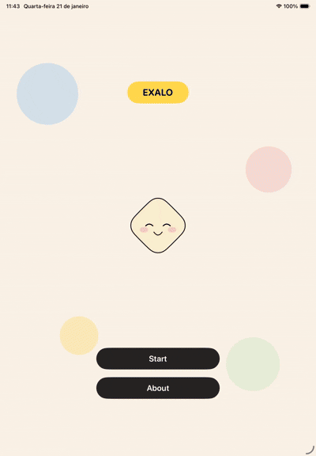
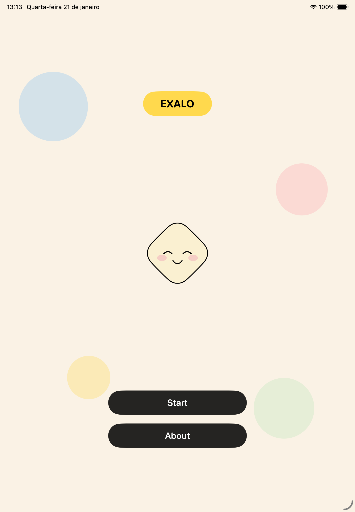
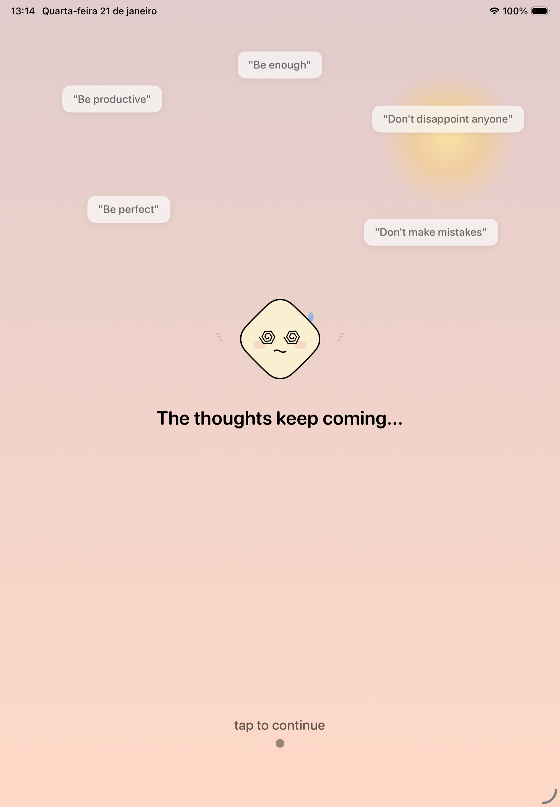
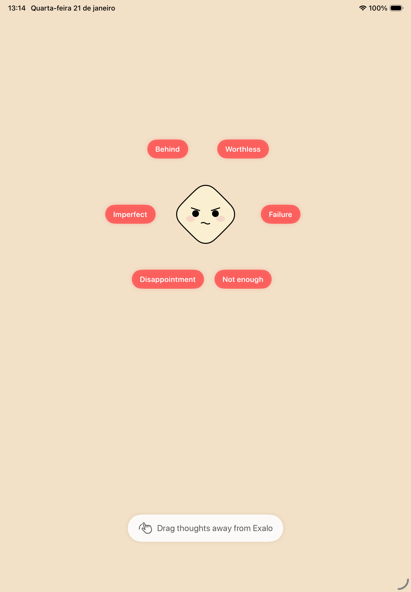
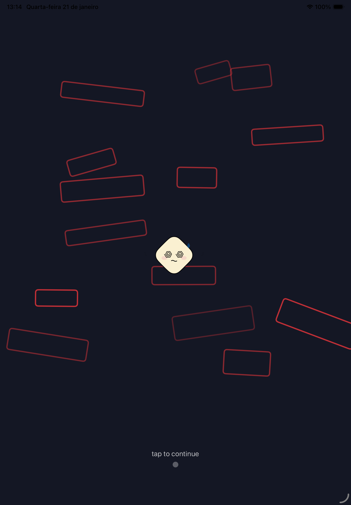
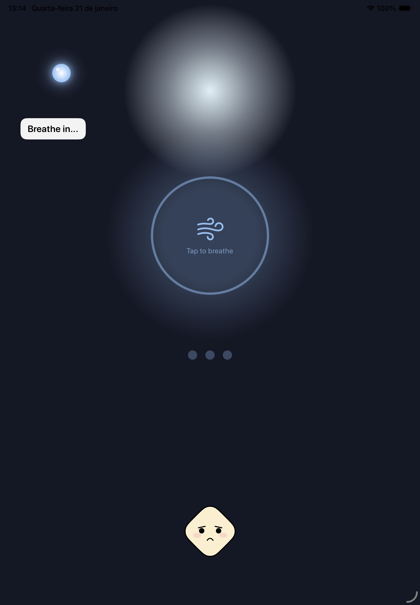
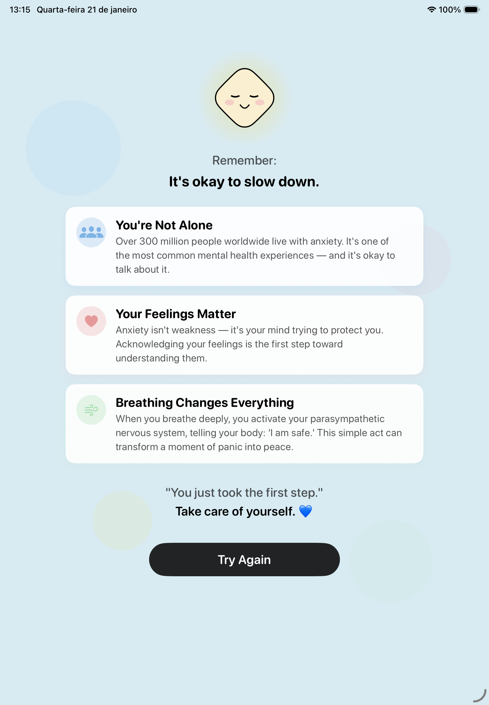

# Exalo

[](https://developer.apple.com/ipados/)
[](https://swift.org)
[](https://developer.apple.com/swift-student-challenge/)
[](LICENSE)

An interactive story about anxiety and self-pressure that ends in a guided breathing exercise. Built as a Swift Playgrounds app for the Swift Student Challenge 2026.

<p align="center">
  
</p>

## Table of Contents

- [About](#about)
- [Features](#features)
- [Screenshots](#screenshots)
- [Built With](#built-with)
- [Getting Started](#getting-started)
- [Project Structure](#project-structure)
- [License](#license)

## About

Exalo follows a character through an ordinary day that slowly becomes
overwhelming. The player interacts with each scene, from dragging intrusive thoughts
away to watching the pressure build, until the story stops and asks them to breathe.
The goal is to show, in a few minutes, that sometimes the right answer is to pause.

## Features

- Story split into acts: prologue, morning, work, inner thoughts, breaking point, overwhelm, light and ending
- Drag-to-dismiss interaction for intrusive thoughts
- Guided breathing exercise driven by touch, with haptic feedback
- Fully offline, no external assets or dependencies

## Screenshots

| Home | Morning | Thoughts |
| :---: | :---: | :---: |
|  |  |  |

| Overwhelmed | Breathing | Ending |
| :---: | :---: | :---: |
|  |  |  |

## Built With

- SwiftUI
- Swift Playgrounds app package (`.swiftpm`)
- A single `GameState` enum driving scene navigation

## Getting Started

Requirements: Swift Playgrounds 4.5+ on iPad or Mac, or Xcode 16 or later.

```bash
git clone https://github.com/EnzoFerroni/Exalo.git
open Exalo/Exalo.swiftpm
```

Best experienced on an iPad or an iPad simulator.

## Project Structure

```
Exalo.swiftpm/
├── MyApp.swift            App entry point
├── ContentView.swift      Scene router
├── Models/GameState.swift Story states
├── Components/            Character, shared views, haptics
└── Views/                 One view per scene
```

## License

Released under the [MIT License](LICENSE). Copyright (c) 2026 Enzo Ferroni.
